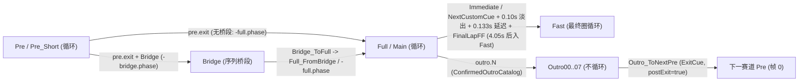
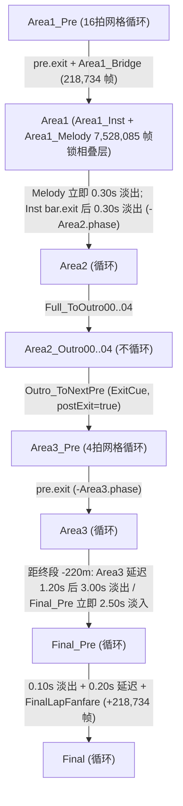

# 《马力欧卡丁车 世界》音乐衔接机制详解

本文档面向音频工程开发者与原声爱好者，严格对齐 **Mario Kart World v1.8.0 游戏内实机逆向提取报告**（`BgmAll.Product.180.bars.zs` 全部 650 条流、`Default.game__SoundBgmSetting.bgyml`、`main.bin` `SoundBgmMgr` 状态机及全图 1,311 个 Banc 触发器审计）与 JukeKart `Beta 0.1.6` 源码实现，系统说明本作的动态配乐结构、拍点/相位对齐模型、赛内阶段切换、特殊赛道编排、跨赛道路线连程以及无接缝实时播放的底层机制。

---

## 1. 为什么《马力欧卡丁车 世界》的配乐不是“一首完整的 MP3”

在《马力欧卡丁车 世界》中，赛道音乐并不是按固定顺序烘焙好的单一音轨，而是拆分为一组可由运行时按比赛进度与乐句拍线动态编排的 **BWAV 音频片段（stems）**。`BgmAll.Product.180.bars.zs` 共收录 **650 条 BGM 音频流**（29 条主赛道、彩虹之路 15 流、v1.8.0 新增 10 条 SFC 复古赛道共 5 组 10 流、对战 16 流、复古任务 5 流、菜单/过场/序列 64 流、点唱机 227 流）。一条常规赛道通常包含 **5～8 个独立 2 声道文件**：

- **前奏（`Pre_Short` / `Pre`）**：入场与开跑前循环段，直到正式进入主赛道。
- **过渡桥段（`Bridge`）**：连接前奏与主旋律的短桥段（并非所有赛道都有，且分为“序列桥段”与“叠层桥段”两类）。
- **主循环（`Full` / `Main`）**：比赛主体音乐，具备带前导引子的循环窗口。
- **最终圈加速版（`Fast` / `SFC_Fast` / `FL`）**：独立的预渲染编曲资产（平均加速 `1.1803×`，SFC 达 `1.30–1.56×`；**全作唯一使用实时变速的特例**是无敌星 `SE_Item_Star_BGM_Stereo_00`，末圈实时 `1.30×`）。
- **多个冲线尾奏（`Outro00`～`Outro07`）**：对应主旋律不同乐句位置的专属收尾，让玩家无论在曲中哪个乐句冲线，都能在最近的拍点自然收束。

> **MKW v1.8.0 架构底线验证**：
> - **不存在 MK8 风格“第 1 名领跑额外鼓点音轨”**：全部赛道交互 BGM 均为独立 2 声道文件，多版本/多声部（`Cinema`、`SnowMountain`、`DonkeyKong Pattern3..5`、`Rainbow Area1`）通过**逐样本锁定的独立 2ch BWAV 并行播放**实现。
> - **全部 24 条 6 声道流均为 5.1 过场/片头音频（非赛道分轨）**：含 2 条 DSP-ADPCM（首次启动）与 22 条 NintendoOpus（8 大奖赛片头、12 条逐字节完全一致的 `Dm_SV01..12_OP` 生存赛片头、`Dm_RainbowAppears`、`Dm_MirrorModeOpen`），实测全解码确认 **24/24 条 LFE 声道均为静音（`-96.05 dBFS`）**，主能量位于 L/R/Ls/Rs（其中 3 条含活跃中置 C）。
> - **Alto BGM 图表为空桩**：`romfs/Sound/Bgm/bgm.Product.180.byml.zs` 的 `BGM={}`、`Hierarchy=[]`（仅保留 66 个 Murmur3-32 哈希全局属性声明，运行时 0 调用）；全部音乐调度均由 C++ `game::SoundBgmMgr`（`0x02439500..0x02442000`）直接驱动 `SLink2` + `SoundBgmSetting` + `AMTA`/`MINF` 完成。

以 `BGM_Stage_Coaster` 实测数据为例（48 kHz 立体声）：

| 角色 | 文件示例 | 采样帧数 | 时长 | 循环窗口（帧） |
|---|---|---:|---:|---|
| `Pre_Short` | `BGM_Stage_Coaster_Pre_Short.bwav` | 534,857 | 11.143 s | `205,714 .. 534,857` |
| `Pre` | `BGM_Stage_Coaster_Pre.bwav` | 2,427,426 | 50.571 s | `452,571 .. 2,427,426` |
| `Bridge` | `BGM_Stage_Coaster_Bridge.bwav` | 88,320 | 1.840 s | 无 |
| `Full`（Main） | `BGM_Stage_Coaster.bwav` | 3,373,711 | 70.286 s | `493,714 .. 3,373,711` |
| `Outro00` | `BGM_Stage_Coaster_Outro00.bwav` | 226,286 | 4.714 s | 无 |

JukeKart 并不靠“猜毫秒数”或直接做生硬淡入淡出来拼接，而是综合三层实机逆向依据驱动原生 C++ 音乐图引擎：

1. **BWAV 音频头**：声道、采样率、编码格式与精确到单采样的硬循环窗口（`loopStart` / `loopEnd`）。
2. **Nintendo BARS `AMTA` / `MINF v1.1` 元数据**（全库 344 条 `MINF` 乐理网格，应用侧 `assets/interactive_minf.json` 覆盖 30 条赛道共 328 条交互记录）：精确 BPM（全库 `90.0001–253.0002 BPM`）、拍号（`4/4` 324 条、`3/4` 20 条：`BigTree` 11 流、`DinoBones` 7 流、`Cave` 主曲+快曲 2 流）、相位抢拍（`phase`）、逐拍拍线（`beats`）、`Pre_TransitionGrid:` 参数（61 流）以及具名转场事件标记（`events`）。
3. **MKW v1.8.0 `Default.game__SoundBgmSetting.bgyml` 与 `main.bin` 运行时参数**：最终圈淡出/号角/加速延迟、双版本非对称淡化时长、彩虹之路分轨淡出与 `-220 m` 预热、202 条连接赛道 `mJukeBoxEndRatio`、13 张点唱机槽位表与 9 首查重历史队列均直接源自实机配置表。

---

## 2. 底层时间坐标：BWAV 硬循环真相与 MINF 拍点模型

### 2.1 BWAV 循环窗口的实测结论

对全部 20,991 个 BWAV 文件（其中 174 个带循环标记的 BGM 文件，及 `BgmAll` 全量 650 流）的逐采样测量揭示了一个常被误解的事实（详见 `docs/research/2026-11-15-bwav-loop-seams.md`）：

- **循环终点之后没有任何冗余音频**：174 / 174 个循环 BGM 均满足 `frames == loop_end`，物理上不存在“写在 `loop_end` 之后的尾部接缝”。
- **BWAV 循环头与 MINF 循环窗口 100% 逐帧一致**：全部 106 个可关联 MINF 的循环 BGM，两者的 `(loopStart, loopEnd)` 误差均为 `0` 帧。
- **循环点并非“可裁切的衔接余量”**：循环终点前与循环起点的波形相似度仅有 4 个文件超过 0.80 且长度均 ≤ 15.5 ms（编码对齐窗口），循环起点前的音频是正常的前置引子。
- **编码细节**：BWAV 支持三种编码——Codec `0`（平面 PCM16）、Codec `1`（Nintendo DSP-ADPCM，含部分文件末块截断与解码历史预测种子校验）、Codec `2`（分块 CELT-only NintendoOpus，每帧 `960` 采样，配置块声明 `120` 采样 = 2.5 ms pre-skip，每声道独立 mono 流）。

因此，**循环无接缝的关键不在“裁剪音源”**，而在于：
1. 严格按 `(loopStart, loopEnd)` 逐采样回绕（并保留 DSP-ADPCM 历史状态与准确 pre-skip）；
2. 在引擎侧提前预取循环起点数据页，防止后台/熄屏下因解码延迟出现 0 采样空洞；
3. 需要切换曲段时，依托 MINF 拍线和转场时间轴完成相位对齐与留尾重叠。

### 2.2 MINF 与 AMTA 的核心要素

每条 `MinfRecord`（定义于 `interactive/MinfCatalog.kt`）包含四个驱动衔接的关键字段：

| 字段 | 含义 | 在衔接中的作用 |
|---|---|---|
| `bpm` / `rate` | 速度与采样率（48,000 Hz） | 换算淡入淡出拍数（如 1 秒 = `bpm / 60` 拍）与拍线时长；全库 `90.0001–253.0002 BPM` |
| `phase` | **抢拍 / 前置偏移**（采样帧数） | 第 1 个强拍（音乐零点）之前的前置引子长度；目标段提前 `phase` 帧启动即可使强拍精准对齐切出点 `G` |
| `beats` | 逐拍时间戳列表 `(frame, label)` | `label ∈ {-4..-1, 1..4}`（`3/4` 拍为 `1..3`），其中 **`label == 1` 表示小节第 1 拍（强拍）**；落于 `[loopStart, loopEnd]` 内的拍点按 `Pre_TransitionGrid:` 规则构成可切出候选集合 |
| `events` | 具名事件采样点字典 | 声明精确的结构交接坐标（见下表） |

主要具名 `AMTA` / `MINF` 标记与用户参数：

- `Pre_TransitionGrid:`（61 条 `_Pre`/`_Pre_Short` 流）：声明前奏切出网格拍数——`3` 拍（4 流：`BigTree`、`DinoBones`）、`4` 拍（默认，`0x0243dc8c`，含 `Cave` 前奏与 `Rainbow Area3_Pre`）、`8` 拍（4 流：`Cinema`、`Lava`）、`16` 拍（1 流：`Rainbow Area1_Pre`）。最小前瞻保护量为 `12,000` 采样（`0.25 s`，`0x0243dea8`）。
- `Pre_NoOverlap`：`main.bin` `0x0243ded4` 确实检查该用户参数（开启时禁止 `_Pre` 与下段重叠），但全量 650 流中出现次数为 **0**，即 v1.8.0 所有 `_Pre` 过渡均启用自然叠化。
- `Bridge_ToFull`：桥段交接给主旋律的采样点。
- `Full_FromBridge` / `Full_SkipForBridge`：主旋律承接桥段时的源入点（可为 `0` 或非零采样，显式跳过主旋律自带的重复引子）。
- `Full_ToOutro00`～`Full_ToOutro07`：主旋律通往各编号尾奏的切出点（覆盖 29 条主赛道 + `Cinema_Pattern2` + `SnowMountain_Pattern2` 共 31 条流，全量逐采样对齐 `docs/research/BGM_Stage_Outro_Triggers.md`）。
- `Outro_ToNextPre`：尾奏交接给下一赛道前奏的退出点（支持分组命名如 `Outro00020305`，并内置岩浆赛道 `Lava Outro01 -> Outro00` 回退匹配）。

### 2.3 MKW v1.8.0 `Default.game__SoundBgmSetting.bgyml` 生效常量速查

> 下表列出 `main.bin` C++ 默认值与零售版 `Default.game__SoundBgmSetting.bgyml` 实际生效覆盖值（全部按 48 kHz 换算）：

| 字段 | C++ 默认 | v1.8.0 `.bgyml` 生效值 | 说明 |
|---|---:|---:|---|
| `FinalLapFanfareDelay` | `0.0 s` | **`0.133 s`**（`6,384` 帧） | 常规最终圈号角 `BGM_Seq_FinalLapFF` 启动延迟（旧曲先 `0.10 s` 淡出） |
| `FastDelay` | `2.9 s` | **`4.05 s`**（`194,400` 帧） | 最终圈加速版 `_Fast` / `_SFC_Fast` 自触发点起的启动延迟（从样本 0 起播） |
| `Rainbow_FanfareDelay` | `0.0 s` | **`0.20 s`**（`9,600` 帧） | 彩虹之路专属号角 `BGM_Rainbow_FinalLapFanfare` 启动延迟 |
| `Stage_ChangePatternFade` | `1.0 s` | **`0.50 s`**（`24,000` 帧） | `Cinema` 双向与 `SnowMountain` 切入 `Pattern2` 的交叉淡化时长 |
| `Stage_ChangePatternFade_Snow` | `2.0 s` | **`2.00 s`**（`96,000` 帧） | `SnowMountain` 从 `Pattern2` 切回主曲（含 `Fast`）的慢速淡化时长 |
| `StageConnect_IntervalToStage` | `2.0 s` | **`2.40 s`** | 连接赛道点唱机开始 `3.0 s` 淡出后，经 `2.4 s` 启动目的地 `_Pre`（最后 `0.6 s` 重叠） |
| `StageConnect_StopByArrivalTime` | `20.0 s` | **`20.0 s`** | 连接赛道预计剩余时间 `< 20.0 s` 时，曲终不再切新曲而静默等待 `_Pre` |
| `JukeBox_FreeRunInterval` | `1.0 s` | **`1.50 s`** | 自由行驶两首点唱机曲目之间的自然静音间隔 |
| `JukeBox_HistoryCount` | `1` | **`9`** | 点唱机防重复历史环形缓冲区深度（最多顺延重试 22 次） |
| `JukeBox_SelectListInterval` | `3` | **`4`** | 生态首曲列表连续播放 4 次后，第 5 次切入 `TypeAll` 通用列表并重置 |
| `JukeBox_FreeRunVolume` / `OnBoost` | `0.70` / `0.7854` | **`0.70`** / **`0.7854`** | 自由行驶基准音量（≈ `-3.1 dB`）与大音量开关下增益；主 BGM `Boost_Volume = 1.412`（`+3.0 dB`） |
| `DelayAfterCountdown` / `CourseSelect_StartDelay` | `0.8 s` / `0.8 s` | **`0.80 s`** / **`0.68 s`** | 起跑倒计时结束后常规赛道 BGM 延迟 / 选图界面延迟 |
| `Mission_BgmDelay` / `Mission_BgmFade` / `StartDemoEndFade` | `0.75` / `1.5` / `2.0 s` | **`0.50 s`** / **`1.50 s`** / **`2.75 s`** | P 开关 / SFC 复古任务 BGM 启停与淡出时长 |

---

## 3. 核心转场引擎：`TransitionTimeline` 四元组与同步点

JukeKart 的原生 C++ 引擎（`engine/native/runtime/RuntimeTransitions.cpp`）以 **音乐图（Music Graph，二进制协议 `P2G1`，含 `TransitionTimeline` 时升级至版本 14）** 统一表达所有衔接。

一次转场由 **同步点（`SyncPoint`）** 确定源曲段的切出基准帧 `G`（`sourceSync`），再由 **`TransitionTimeline`** 四元组定义相对于 `G` 的精确采样级调度：

```
时间轴（以源曲段同步点 G = sourceSync 为 0 点）：

  G + bridgeStart       G (sourceSync)         G + destinationStart    G + destinationCommit
       │                     │                          │                       │
───────┼─────────────────────┼──────────────────────────┼───────────────────────┼────▶
       ▼                     ▼                          ▼                       ▼
  [桥段启动]             [源段离开]               [目标段开始发声]         [目标段正式提交]
  (若存在 Bridge)        (若 postExit=true        (支持负偏移提前抢拍，     (成为新的主前台段，
                          则继续留尾衰减)          从 destinationSource     旧段淡出或自然结束)
                                                   采样坐标起播)
```

四元组字段含义（`MusicGraphBuilder.TransitionTimeline`）：

1. **`bridgeStart`**：相对 `G` 启动桥段的传输帧偏移（常为 `-bridge.phase`，即桥段的弱起/抢拍在 `G` 之前提前进入）。
2. **`destinationStart`**：相对 `G` 启动目标曲段的传输帧偏移（例如无桥段时为 `-target.phase`，使目标强拍恰好踩在 `G` 上）。
3. **`destinationCommit`**：相对 `G` 正式提交目标段为新前景（Foreground）的时刻；协议要求 `destinationCommit >= destinationStart` 且（有桥段时）`destinationCommit >= bridgeStart`。
4. **`destinationSource`**：目标曲段音频源的起始采样坐标（通常为 `0`，在 `Full_FromBridge` / `Full_SkipForBridge` 非零时直接从该偏移起播）。

引擎支持的调度能力：

- **7 种同步点（`SyncPoint`）**：`Immediate(0)`、`NextBeat(1)`、`NextBar(2)`、`NextGrid(3)`、`ExitCue(4)`、`NextCue(5)`、`NextCustomCue(6)`。
- **进入模式（`EntryMode`）**：常规切段使用 `EntryCue(0)`；同曲双版本实时切换使用 `SameTime(1)`，由 `projectSameTime()` 将当前源播放进度跨 `segment.loop` 映射到目标段同相位位置。
- **留尾与淡化（`postExit` / `Fade`）**：
  - `postExit = true` 允许旧段或桥段在逻辑退出后继续释放自然残响（`stopFrame = -1`），不会在切点硬截断尾音。
  - 若带有限时淡出的循环段在淡出期间抵达源文件末尾，引擎会设置 `voice.departureRepeat = true`，确保旧段在淡出完成前继续平滑循环而不提前断声。
  - 淡化曲线支持 5 种形状：`Linear`、`Hold`、`SCurve`（三次 Hermite `x²(3 - 2x)`）、`EaseIn`（`x²`）、`EaseOut`（`1 - (1 - x)²`）。

---

## 4. 单条赛道的 8 种音乐衔接机制



### 4.1 前奏到主旋律（`Pre` / `Pre_Short` → `Bridge` → `Full`）

非尾奏段在编译时一律保持循环（有实测循环头则循环 `[loopStart, loopEnd]`，无循环头则整段循环），避免前奏放完直接静默停机。依据 MKW v1.8.0 逆向确认的 `AMTA Pre_TransitionGrid:` 规则，`pre.exit` 候选点严格按每条赛道的拍点网格生成（`BigTree` / `DinoBones` = `3` 拍且编译为 `3/4` 拍号 `numerator = 3`，`Cinema` / `Lava` = `8` 拍，`Rainbow Area1_Pre` = `16` 拍，其余常规赛道与 `Rainbow Area3_Pre` = `4` 拍）。切入主旋律分为三种情况：

1. **无桥段直连**：
   - 在 `Pre` 的 `pre.exit`（严格按 `Pre_TransitionGrid:` 生成的循环内拍点网格）触发；
   - `TransitionTimeline(0, -full.phase, 0, 0)`：`Full` 在 `G - full.phase` 提前启动抢拍，强拍精准落在 `G` 上，`Pre` 在 `G` 点配合 `postExit = true` 自然收尾。
2. **序列桥段（`BridgeCatalog` 中 14 条实测 `SEQUENCED` + `ChocoMountain` 1 条推断赛道）**：
   - 计算交接时刻：`handover = bridgeExit - bridge.phase`（其中 `bridgeExit` 取自 `Bridge_ToFull`；特例 `ChocoMountain` 的 `Bridge_ToFull` 标记为空，按实测采用桥段自然结尾 `bridgePart.frames`）。
   - `TransitionTimeline` 编译为：
     - `bridgeStart = -bridge.phase`
     - `destinationStart = (fullEntry == null) ? (handover - full.phase) : handover`
     - `destinationCommit = max(0, handover)`
     - `destinationSource = fullEntry ?: 0`（`fullEntry = Full_FromBridge ?: Full_SkipForBridge`）
   - 典型实测特征：
     - **提前叠入（`preEntry > 0`）**：`Central`（1,125 帧）、`DKJungleParkway`（5,269 帧）、`DKPass`（5,853 帧）、`Lava`（1,999 帧）、`WestCity`（5,625 帧）。
     - **非零主旋律入点（`fullSourceOffset > 0`）**：`ChocoMountain`（38,400 帧）、`DinoDinoJungle`（420,438 帧）、`IceBuildings`（34,286 帧）、`ToadFactory`（110,454 帧），用于跳过主旋律开头已被桥段演奏过的重复引子。
3. **叠层桥段（6 条 `LAYERED` 赛道：`AirshipFortress`、`DesertHills`、`DinoBones`、`FirstCircuit`、`MooMooFarm`、`SFCMarioCircuit`）**：
   - MKW v1.8.0 审计证实这 6 条赛道的 `Bridge` 均无非零 `Bridge_ToFull` 序列交接点（`AirshipFortress` 与 `DinoBones` 为 `0`），不编排为串行桥段。

### 4.2 最终圈加速切换（`Full` → `FinalLapFF` → `Fast`）

普通赛道共享最终圈号角资产 `BGM_Seq_FinalLapFF.bwav`（48 kHz 双声道，总长 `268,759` 帧 ≈ `5.599 s`），由 `FinalLapFanfareCompiler` 依据 MKW v1.8.0 `Default.game__SoundBgmSetting.bgyml` 与 `main.bin`（`0x005016d4..0x005019f0`）精确参数注入：

- **精确参数（48 kHz）**：
  - 原 `Full` 淡出：`stopAllBgm` = **`0.10 s`（`4,800` 帧）**线性淡出（`postExit = true`）。
  - 号角起播延迟：`FinalLapFanfareDelay` = **`0.133 s`（`6,384` 帧）**（C++ 默认 `0.0 s`，`.bgyml` 实机生效 `0.133 s`）。
  - 加速段起播延迟：`FastDelay` = **`4.05 s`（`194,400` 帧）**（相对号角第 0 帧为 `188,016` 帧 ≈ `3.917 s`，号角末尾约 `1.682 s` 余韵叠在 `_Fast` 开头自然消散）。
- **行为规则**：
  - 默认以 `SyncPoint.Immediate` 立即响应（开启“完美拍点”设置时改为对齐 `beat1.exit` / `fast.exit` / `NextBar`）。
  - 在触发点 `G`，原曲段在 `0.10 s` 内线性淡出，`FinalLapFF` 于 `G + 6,384` 帧起播，其逻辑 `exit = 188,016` 帧但 clip 保留全部 `268,759` 物理帧。
  - 在 `G + 194,400` 帧时 `Fast` 从帧 0 起播（平均加速 `1.1803×`；其中 `PeachBeach` 与 `DKPass` 的 `_Fast` 资产本身已将前奏剪短 2.8–8.4 秒），同时依靠 `postExit = true` 让 `FinalLapFF` 剩余尾音自然叠在 `Fast` 开头衰减。
  - **全作唯一实时变速特例**：无敌星音乐 `SE_Item_Star_BGM_Stereo_00`（6.667 s 循环）在末圈通过 `ExpressionDirector`（`0x00513310`）施加 `1.30×`（`0x3FA66666`）实时变速变调；所有赛道均使用独立预渲染 `_Fast` / `_SFC_Fast` / `_FL` 音频流。

### 4.3 冲线尾奏切换（`Full` → `Outro00..07`）

- 每条赛道在 `ConfirmedOutroCatalog`（对应 `docs/research/BGM_Stage_Outro_Triggers.md`，全量 31 流与 MKW v1.8.0 AMTA 逐采样一致）记录了 `Outro00`～`Outro07` 各自在 `Full` 中的精确切出帧（同一编号可对应多个乐句点，例如 `ToadFactory` 的 `Outro00_1`～`Outro00_9`）。
- 编译器在 `Main` 段注入 `"outro.$n"` Cue；点击触发时，`NativeInteractiveDriver.takeOutro()` 遵循 `0.25 s`（`12,000` 帧）最小前瞻门槛跨循环边界计算最近可达的尾奏点，使引擎在下一个对应乐句无缝切入不循环的 `Outro` 段。

### 4.4 同速双版本无缝切换（`Cinema` / `SnowMountain`）

`Cinema`（210 BPM）与 `SnowMountain`（170 BPM）拥有两套完整编曲版本（`Pattern1` 与 `Pattern2`，含各自的 `Fast`）：

- **逐样本锁定验证**：`Cinema` 主曲 `Main`/`Pattern2` 均精确为 `2,880,000` 帧（210 BPM），`Fast`/`Fast_Pattern2` 均精确为 `2,562,711` 帧（236 BPM）；`SnowMountain` 主曲 `Main`/`Pattern2` 均精确为 `2,846,116` 帧（170 BPM），`Fast`/`Fast_Pattern2` 均精确为 `2,468,568` 帧（196 BPM）；采样率、BPM、`phase`、循环窗口和逐拍网格 **100% 一致**。
- **游戏实机触发与前瞻算法**：`SoundBgmMgr::switchDynamicStagePattern`（`0x0243b078`）响应 `SystemObj_CinemaInsideArea_00` 与 `SystemObj_SnowMountainSoundArea_00` 空间触发器，使用 `+200 ms`（`+9,600` 采样）相位预读与 `0.02` 进度迟滞（末圈自动识别切换 `_Fast ↔ _Fast_Pattern2`）。
- `FullVersionCompiler` 建立双向 `SyncPoint.Immediate` + `EntryMode.SameTime` 转场，采用 MKW v1.8.0 `Default.game__SoundBgmSetting.bgyml` 实机生效淡化时长（C++ `.rodata` 默认 `Stage_ChangePatternFade = 1.0 s`，`.bgyml` 覆写为 `0.5 s`）：
  - **`Cinema`（幽灵影院，双向）**：`Stage_ChangePatternFade` = **`0.5 s`（`24,000` 帧）**同相位交叉淡化；`Main` 与 `Pattern2` 均合法挂载全部 6 个尾奏（`Outro00..05`），且前奏 `Pre` / `Pre_Short` 严格遵循 8 拍网格（`Pre_TransitionGrid: 8`），无 `_Bridge`。
  - **`SnowMountain`（罗莎塔天文台，非对称）**：切入 `Pattern2`（水上）/ `Fast_Pattern2` 使用 **`0.5 s`（`24,000` 帧）**，切回 `Main`（普通）/ `Fast` 使用 `Stage_ChangePatternFade_Snow` = **`2.0 s`（`96,000` 帧）**交叉淡化；前奏使用 4 拍网格且无 `_Bridge`。需要特别注意的是，`SnowMountain_Pattern2` 仅确认拥有 **6 个尾奏（`Outro00..05`）**（不含 `Outro06`/`Outro07`），互动图与自定义流程编辑器均严格限制仅允许 `Outro00..05`。
- **混合预解码策略**：由于 `Immediate + SameTime` 需要目标当前页立即可用（流式冷页会触发 `DeadlineMiss`），且全量预解码所有资产会超出原生 128 MiB 预算，因此仅将两版 `Full` + 两版 `Fast` 共 4 个长曲完整预解码（`Cinema` 83.05 MiB、`SnowMountain` 81.10 MiB，均低于 128 MiB），其余 `Pre`/`Outro` 仍保持流式解码。

### 4.5 五区域递进切换与待执行取消（`DonkeyKong`）

- `DonkeyKong`（174 BPM）的 `Full` 与 `Pattern2`～`Pattern5` 构成 5 个连续赛道区域（配合第 6 段 `Fast` `10.05 s` 短循环构成 6 段式赛道）；其中 `Pattern3`/`Pattern4`/`Pattern5` 三轨均**逐样本锁定在 `1,191,722` 帧**（循环窗 `132,414..1,191,722`）。
- `DonkeyRegionCompiler` 在 5 个区域间生成 20 条有向转场边，切出网格严格遵循 MKW v1.8.0 逆向结果（`0x0243c230`）：
  - **区域 1（`Main`）**：每 `4` 拍（每小节 `label == 1`）可切出；持有全部 7 个尾奏（`Outro00..06`）。
  - **区域 2～5（`Pattern2..5`）**：以各自 `loopStart` 对齐的 **8 拍网格**（`Pattern2` 落在第 `4, 12, 20, 28, 36, 44, 52, 60` 拍；`Pattern3/4/5` 落在第 `0, 8, 16, 24, 32, 40, 48, 56, 64, 72` 拍）作为切出点 `region.exit`，目标段按 `-destination.phase` 对齐进入；`Pattern2..5` 无独立尾奏与独立加速流，第 6 段切入 `BGM_Stage_DonkeyKong_Fast` 走标准最终圈流程。
- **无损取消机制**：在目标段尚未启动且源段尚未离开切出点 `G`（且尚未进入 `departureStart`）之前，用户可通过原生稳定命令 `ID 17`（`CancelPendingTransition`）取消排队中的区域切换；取消后输出 PCM 与从未发起切换的参考音频逐采样一致（最大误差 `0`）。

### 4.6 采样锁定叠层与动态增益（`KoopaTroopaBeach` / `Rainbow Area1`）

- `KoopaTroopaBeach`（慢慢龟海滩，默认 5 圈，`SpeakerOverlayCompiler`）将 `SE_Stage_KoopaTroopaBeach_Speaker_Normal` / `Fast` 与对应主音轨放入 **同一 Segment 的多条 Track**，天然保持逐采样相位锁定；桥段 `Bridge` 按 `Bridge_ToFull = 23,226` 与 `Full_FromBridge = 0` 衔接；互动与流程编排中扬声器叠轨支持 **1.0 秒（`48,000` 帧）**平滑淡入/淡出。（游戏内 `Obj_SpeakerKoopaTroopaBeach_Controller` 另由 `game__GameParam_SpeakerKoopaTroopaBeach` 在 `FadeInSamplePosStart = 789,677` 至 `FadeInSamplePosEnd = 990,404` 区间线性淡入音箱动画/HD 震动，并跳过停拍段 `BreakBeatList = [28..33, 64..66, 80, 81]`。）
- `Rainbow Area1` 同理将 `Area1_Inst`（伴奏）与 `Area1_Melody`（主旋律）——双轨逐样本锁定在 `7,528,085` 帧（158 BPM，循环 `1,986,831..7,528,085`）——编排在同一 Segment 内；互动播放中 `Area1_Melody` **默认始终开启**（不提供手动开关），并在 `Area1 -> Area2` 推进时按 v1.8.0 实测规则自动触发分轨淡出。
- 运行时无需重启或重新同步音频流，只需发送 `EngineCommandKind::LayerGain` 命令，在 `0 dB` 与 `-96 dB` 之间做平滑帧级淡入淡出即可完成动态声部控制。

### 4.7 彩虹之路：4 区域 15 资产专属编排（`RainbowInteractiveCompiler`）

彩虹之路拥有全游戏最复杂的独立结构，包含 `M_BgmRainbow.bars.zs` 全部 15 个 `BGM_Rainbow_*.bwav` 资产（含连接进场即播 `Area1_Pre` 跳过点唱机，并在 `Rainbow_00_Fix` `Y = 4,549 m` 处复用 1 枚 `SystemObj_SnowMountainSoundArea_00` 触发 Area 3 声场切换）：



- `Area1 -> Area2`（`0x0243d500`）采用 MKW v1.8.0 实测分轨淡出：触发推进时 `Area1_Melody` 立即通过 `LayerGain` 在 **`0.30 s`** 内淡出（若取消排队则平滑恢复），`Area1_Inst` 持续至下一个 `bar.exit` 后再留尾淡出 **`0.30 s`（`14,400` 帧）**，`Area2` 按 `-Area2.phase` 准拍切入。
- `Area2_Outro00..04` 的逻辑退出点精确设为各自 MINF 的 `Outro_ToNextPre`，完成后自动以 `ExitCue` + `postExit = true` 留尾进入 `Area3_Pre`。
- `Area3 -> Final_Pre`（游戏内由领先车手距终段检查点 **`-220.0 m`** 触发，`0x02439790`）默认立即响应（完美拍点模式对齐 `bar.exit`）：`Area3` 保持原音量 **`1.20 s`（`57,600` 帧）** 后执行 **`3.00 s`（`144,000` 帧）** 淡出，`Final_Pre` 立即执行 **`2.50 s`（`120,000` 帧）** 淡入。
- `Final_Pre -> Final`（`0x0243d8e0`）经专属 `BGM_Rainbow_FinalLapFanfare`（7.06 s）桥接：`Final_Pre` 先淡出 **`0.10 s`（`4,800` 帧）**，`FinalLapFanfare` 按 `Rainbow_FanfareDelay` = **`0.20 s`（`9,600` 帧）** 延迟起播，并在号角第 0 帧后 **`218,734` 帧（`4.557 s`）** 切入 `Final`（相对触发点共 `228,334` 帧），同时 `Fanfare` 剩余尾音自然叠在 `Final` 上衰减。

### 4.8 标题曲、SFC/对战双态曲、杯赛片头与制作人员名单（`ExtraInteractiveCompilers`）

- **标题曲（`compileTitlePlan`）**：`TitleExtended`（口琴扩展版）播放至 `ExitCue` 后以 `postExit = true` 无缝接续 `TitleNormal`；支持切换 `TitleBrassCut` 及各 `Outro`。
- **SFC 任务赛道与对战曲（`compileTwoStateLoopPlan`）**：
  - **v1.8.0 SFC 复古独立赛道（10 条赛道 / `M_BgmSFC.bars.zs` 5 组主题 + `_SFC_Fast`）**：复用 `FinalLapFanfareCompiler`（`0.10 s` 淡出 + `0.133 s` 延迟 + `4.05 s` 进入 `_SFC_Fast`）。
  - **对战模式（8 场地，`BGM_Battle_00..07` → `_FL`）**：MKW v1.8.0 证实对战最后 1 分钟 **不播放 `BGM_Seq_FinalLapFF`**，而是直接对原曲做 `0.10 s` 淡出后切入加速版 `_FL`（内置 8 首对战组曲亦同步移除号角）。
- **杯赛 / 生存赛片头（`compileOverlaidOpeningGraph`）**：6 声道片头动画音轨（如 `Dm_KinokoOp`，在流式解码侧按 ITU-R BS.775 规范无削波下混至立体声，并保持与 `beta01` 一致的响度校准；12 条生存赛片头 `Dm_SV01..12_OP` 经审计逐字节完全一致）与 2 声道标题字幕音轨（`BGM_Seq_CourseTelop_*`）在同一 `Segment(100)` 内按 `deltaFrames` 精准错位叠放。
- **制作人员名单（`BGM_StaffRoll` / `nm_special_119`）**：内置 18 段赛道主题动态进度条特效（`StaffCreditsProgressTheme.kt` + `MkwSliderSpecialStyle.kt`），支持左至右主题色滑入擦除、双赛道重叠段两段色分割以及彩虹之路流动渐变；对 Nintendo Music 特别提供版（`nm_special_119`）在首次播放时通过 10 ms RMS 能量包络互相关自动对齐偏移（兜底 `-2,920 ms`）。

---

## 5. 跨赛道、世界地图路线与自由行驶点唱机引擎

《马力欧卡丁车 世界》最具代表性的设计，是把多条赛道、中间公路与自由行驶漫游串成一场不间断的无缝音乐旅程。JukeKart 在路线模式、队列编排与自由行驶电台中完整复现了 MKW v1.8.0 逆向证实的这套体系：

### 5.1 赛道组曲（`CourseMedleyCatalog`）与变体规则

`assets/course_medley_catalog.json` 收录了 **121 首 48 kHz 赛道组曲**（所有 `FinalLapFF`、`Cinema`/`SnowMountain Pattern2`、`Cinema_a_alt` 8 拍网格与 `121_Rainbow_a` 均已按 v1.8.0 参数校准），按用途提供多种结构变体：`a`（30 首，标准完整）、`a_alt`（4 首：`DonkeyKong` 1 循环主曲+尾奏、`SnowMountain`/`Cinema` 纯普通版、`KoopaTroopaBeach` 无扬声器版）、`b`（29 首，生存赛首站，其中 `53_KoopaTroopaBeach_b` 在 `Pre_Short` 之后严格对齐无扬声器版 `52_KoopaTroopaBeach_a_alt` 共 6 个片段）、`c`（29 首，大奖赛首站）、`d`（29 首，生存赛末站）。

路线播放时由 `RoadJukeboxCatalog.resolveSuiteVariantForStop()` 自动决定每站选用的组曲变体：

| 套件模式 | 路线类型 | 第 1 站 | 中间站 | 末站 |
|---|---|---|---|---|
| `COMPLETE_SUITE`（完整套件） | 任意 | `a` | `a` | `a` |
| `GAME_SUITE`（游戏实机套件） | **大奖赛 / 常规自定义路线** | `c` | `a` | `DonkeyKong` 用 `a_alt`，其余用 `a` |
| `GAME_SUITE`（游戏实机套件） | **生存赛 / 生存赛直连自定义路线** | `b` | 有 `a_alt` 用 `a_alt`（`DonkeyKong` / `SnowMountain` / `Cinema` / `KoopaTroopaBeach`），其余用 `a` | `d` |

官方路线开场会自动在队列最前插入对应的 `OverlaidOpening`（大奖赛杯赛片头或 `opening_knockout` 生存赛片头）。在游戏内生存赛（`0x02439a90`）中，领先车手距离下段边界默认提前 **200 米** 触发预测切出，唯独下一站为 **`StormClouds`（？神殿）** 时特判放宽为 **500 米**（`0x02439e84`）。

### 5.2 世界地图 202 条有向连接边、自由行驶 13 张官方曲表与道路规则

- **202 条有向连接边（`assets/stage_connections.json`）**：严格对齐 MKW v1.8.0 实机连接表（移除了此前混入的 12 条 `LongRally` 伪边）：共 `137` 条 `InterStageEx1` + `65` 条 `InterStageEx2`；构成 **96 对双向边 + 10 条严格单向边**（`Central → Rainbow` 唯一汇点，`Coaster / DesertHills / StormClouds → KoopaTroopaBeach`，`DonkeyKong → Central / DesertHills / FirstCircuit`，`IceBuildings → LagoonCity / RaftingRiver`，`SFCMarioCircuit → Central`）。
  - **点唱机终止进度（`mJukeBoxEndRatio`）**：默认公式 $\max((s_9 \cdot L - 650.0) / L,\; 0.75 \cdot s_9)$，另有 **4 条手工覆写边**（`Cave → Cinema`: `0.80`，`SFCMarioCircuit → Central`: `0.80`，`DKPass → SnowMountain`: `0.75`，`ShyGuyBazaar → WarioStadium`: `0.75`）。
  - **抵达防半截新歌与衔接**：曲终若预计剩余时间 `< StageConnect_StopByArrivalTime`（`20.0 s`）则不再起新曲；越过 `mJukeBoxEndRatio` 时执行 `3.0 s` 淡出并延迟 `StageConnect_IntervalToStage = 2.4 s` 启动目的地 `_Pre`（最后 `0.6 s` 交叉重叠）。
- **13 张官方 `SoundJukeBoxPlaylist` 槽位表与游标状态机（`assets/jukebox_playlists.json` & `FreeRoamJukeboxEngine`）**：
  - 完整收录 13 张有序槽位表（共 **1,102 槽位 / 227 首唯一曲目**，**0 首孤儿曲目、0 条坏引用**）：其中 **94 首单人自由行驶独占**（93 首 `IsFreerunOnly = true` + 唯一例外 `M344` MK64《彩虹之路》仅列于 `Night` 4 槽）、**25 首仅赛事/连接赛道可听**（含 4 首仅限 `レース夜` 的历代彩虹之路：`M331` MKDD、`M339` MKSC、`M440` MKDS、`M527` MKWii）、108 首共享。`IsFreerunOnly` 与 `EntryPoints` 经二进制证实为离线制作期约束元数据，运行时由 XorShift128 均匀随机初始化游标并按 `cursor = (cursor + 1) % size` 顺序步进，完整保留官方设计的 4×/3×/2×/1× 槽位权重与最小同曲间距（如 `Default` 为 22 槽）。
  - 内置 `JukeBox_HistoryCount = 9` 首去重历史环形缓冲（最多顺延重试 22 次，生态表耗尽后回退 `TypeAll` 再试 22 次）、`03:00–19:00` 白天（Morning/Noon）/ `19:00–03:00` 夜晚（Evening/Night）24 小时时钟规则，以及自由行驶自然切曲 `JukeBox_FreeRunInterval = 1.5 s` 静默呼吸间隔。
  - 自由行驶电台完整支持 **7 种模式**（含 5 种游戏内单人自由行驶曲库模式 + 2 种联网/赛事模式）：
    1. **自动时段（`AUTO_CLOCK`）**：随本机 24h 时钟在 `Default`（581 槽 / 172 曲）与 `Night`（137 槽 / 39 曲）间自动切换。
    2. **单人白天（`SOLO_DAY`）**：`Default`（581 槽 / 172 曲）。
    3. **单人夜晚（`SOLO_NIGHT`）**：`Night`（137 槽 / 39 曲）。
    4. **游戏内自由行驶全曲库（`SOLO_ALL`）**：按比例交错合并 `Default ∪ Night`（718 槽 / 202 首唯一曲目，严格排除 25 首仅赛事曲）。
    5. **仅自由行驶独占曲（`FREEROAM_ONLY`）**：`IsFreerunOnly = true` 专属池（93 首）。
    6. **联网白天（`ONLINE_DAY`）**：`Race`（127 槽 / 127 曲）。
    7. **联网夜晚（`ONLINE_NIGHT`）**：`24040117_J25YUWHR`（`レース夜`，111 槽 / 38 曲）。
  - 纯自由行驶路线同步支持 **`PureFreeRoamTrackPool.ROUTE_RULES`（按路线规则）** 与 **`PureFreeRoamTrackPool.GAME_FREE_ROAM`（游戏内自由行驶曲库）** 双曲库切换。
- **6 种路线道路规则（`RoadJukeboxCatalog.RoadMusicRuleMode`）**：
  1. **`AUTO`（自动）**：官方大奖赛用 GP 池，官方生存赛用直连交接，自定义路线默认 VS 白天。
  2. **`GRAND_PRIX`（大奖赛）**：23 条官方 GP 路段 `PrimaryCourse` 专属池（共 79 曲，`Central -> Rainbow` 固定跳过点唱机直通彩虹之路 `Area1_Pre`），受 9 首历史去重保护。
  3. **`VS_AUTO`（VS赛 · 自动昼夜）**：依本机 24 小时时钟在 `03:00–19:00` 走白天生态群系规则、`19:00–03:00` 走夜晚规则。
  4. **`VS_DAY`（VS赛 · 白天）**：8 大生态群系首曲表（覆盖 19 条证实赛道，0 条猜测）按 `JukeBox_SelectListInterval = 4` 与 52 首 `TypeAll` 通用表做 **4:1 节流交替**（202 条边中 `TypeAll` 83 条、其余 8 生态共 118 条、彩虹之路 1 条）。
  5. **`VS_NIGHT`（VS赛 · 夜晚）**：使用 `24040117_J25YUWHR`（`レース夜`，38 首 / 111 槽位，含 35×`3` 槽 + 3×`2` 槽），覆盖白天生态群系表。
  6. **`KNOCKOUT_DIRECT`（生存赛直连）**：官方生存赛与自定义路线均可选；不插入道路点唱机曲目，站点之间直接启用原生 `"Outro → Next Pre"` 无缝拍点交接。

### 5.3 多段原生连播链路（`CourseMedleyChainCompiler`）与引擎热切换

当队列中出现 2 首及以上可原生交接的赛道组曲（例如 6 站生存赛）时：

1. **多段单图编译**：`CourseMedleyChainCompiler` 将连续最多 **`MAX_CHAIN_SEGMENTS = 8`** 首组曲编译进同一份多段音乐图（`segId = 100 + idx`），一次性容纳完整的 6 站生存赛。
2. **`Outro_ToNextPre` 精准接力**：
   - 第 `i` 段的逻辑退出点 `exit` 设为该段尾奏对应的 `outroHandoverFrame`（取自 MINF `Outro_ToNextPre`；若为 `Lava Outro01` 则自动回退 `Lava Outro00` 的交接点）。
   - 转场规则为 `SyncPoint.ExitCue` + `EntryMode.EntryCue` + `postExit = true` + `TransitionTimeline(0, 0, 0, 0)`。
   - **刻意不减去下一段的 MINF `phase`**：因为 `Outro_ToNextPre` 本身已对准下一赛道 `Pre` 的第 0 帧，这样前一站的尾奏余音自然衰减，下一站的前奏从第 0 帧零误差起播，不会抢跑也不会出现静音缝。
   - `PlaybackSession.poll()` 监测到当前活跃段推进后，自动向引擎预排队下一段过渡（`autoAdvance[segId]`），并同步更新 UI 曲目窗口与进度条偏移。
3. **跨图切换零断流（输出流热切换）**：
   - 当队列跨越两个独立原生图（例如不同点唱机曲目、或单曲循环的组曲重新开始）时，`LinearPlaybackCoordinator` 会在后台线程预先构建并启动下一个 `AudioEngine`，再通过 `NativeOutput::rebind()`（无锁 `callbackGen_` 原子替换，并校验采样率兼容性）直接把新引擎热挂到正在运行的音频输出流上，**全程不关闭、不重建系统音频流**，并将旧引擎释放卸载到 `Dispatchers.IO`。

---

## 6. 后台、熄屏与蓝牙耳机下的无接缝工程保障

即使时间坐标精确到单采样，在真实 Android 手机（尤其是熄屏降频、MIUI 后台策略与蓝牙 TWS 耳机场景）下，任何一次解码阻塞、线程抖动或蓝牙控制包冲突都会表现为可听见的卡顿、接缝或单耳断连。JukeKart 在运行时层叠加了三道防线：

1. **三级前瞻预取与无锁页缓存（`SourcePageCache` / `RuntimeLookAhead` / `RuntimePreparation` / `Voice`）**：
   - 流式页缓存容量 **512 页**（每页 `4,096` 帧 = `32 KiB`，共 16 MiB），后台解码线程 `mkw-decode` 使用 Linux 无锁 `futex` 即时唤醒，优先级（`nice -8`）低于音频实时输出线程（`THREAD_PRIORITY_URGENT_AUDIO`），既不丢唤醒又不抢占输出。
   - **未来片段预热**：所有交互、组曲与路线编译器均为资产设置 **2 秒 `lookAheadFrames`**，在片段到来前提前预解首 4 页。
   - **循环起点预热**：`Voice::next()` 在距循环终点 24 页（≈ 2.05 秒）时预取循环起点 6 页；`EngineRuntime` 在距段循环终点 2.5 秒时锁定循环起点及前 2 秒内的新片段。
   - **转场目标预热**：转场前提前预热目标入口及后续共 **8 页（`32,768` 帧 ≈ 682 ms）** 并自动跨 `clip.loop` 回绕，确保在 `min(sourceSync, preStart, bridgeStart, departureStart)` 前就绪。
2. **倍速与 A–B 终点感知的后台高频交接（`PlaybackService` / `LinearPlaybackCoordinator`）**：
   - 后台轮询常态为 `200 ms`，当距离曲目终点或 A–B 循环终点（按当前 `playbackSpeed` 换算真实墙钟时间）≤ `2.5 s` 时自动切入 **`20 ms` 高频窗口**；单曲循环组曲同样提前预加载下一份引擎。
3. **深度缓冲 `AudioTrack` 与蓝牙链路抗干扰（`AudioOutput` / `PlaybackService`）**：
   - 默认走 Android 标准深度缓冲立体声 `AudioTrack`（`PCM16`、`PERFORMANCE_MODE_POWER_SAVING`、`16,384` 帧 ≈ 341 ms 缓冲区、`2,048` 帧分块写入，Oboe 保留为回退），在 `track.play()` 之前先非阻塞预填 2 块音频（~85 ms）避免启动欠载，并用完整循环处理部分写入。
   - `PlaybackService` 彻底取消了每秒一次的 `MediaSession.setPlaybackState()` 与通知/小组件/磁贴 Binder 刷新，仅在真实状态变化、Seek、变速或循环跳变 ≥ 2 秒时同步，避免蓝牙 AVRCP 控制包与 A2DP 立体声流在 TWS 耳机射频链路上互扰。

---

## 7. 代码模块速查表

| 主题 | 核心源码位置 |
|---|---|
| 音乐图二进制协议与构建器 | `app/src/main/kotlin/com/mylittleblover/mkwplayer/graph/MusicGraphBuilder.kt`、`engine/native/compiled/GraphProtocolIds.hpp` |
| 标准赛道流与桥段目录 | `graph/StageFlowCompiler.kt`、`graph/StageTransitionPlanner.kt`、`library/BridgeCatalog.kt` |
| MINF 交互编译与尾奏触发点 | `interactive/MinfCatalog.kt`、`interactive/MinfInteractiveCompiler.kt`、`interactive/ConfirmedOutroCatalog.kt` |
| 双版本 / 5 区域 / 叠层 / FinalLapFF | `interactive/FullVersionCompiler.kt`、`DonkeyRegionCompiler.kt`、`SpeakerOverlayCompiler.kt`、`FinalLapFanfareCompiler.kt` |
| 彩虹之路 15 资产编排 | `interactive/RainbowInteractiveCompiler.kt` |
| 标题曲 / SFC / 对战 / 片头叠放 | `interactive/ExtraInteractiveCompilers.kt` |
| 组曲目录、自定义流程与多段连播链 | `interactive/CourseMedleyCatalog.kt`、`CourseMedleyCompiler.kt`、`CourseFlowRecipeBuilder.kt`、`CourseMedleyChainCompiler.kt` |
| 世界地图 202 边、13 张点唱机曲表与路线规则 | `library/StageConnections.kt`、`jukebox/FreeRoamJukeboxEngine.kt`、`routes/OfficialRouteCatalog.kt`、`routes/RoadJukeboxCatalog.kt` |
| 制作人员名单动态进度条与偏移校准 | `ui/components/StaffCreditsProgressTheme.kt`、`ui/kit/MkwSliderSpecialStyle.kt` |
| BWAV 头部与 DSP-ADPCM / Opus 解码 | `audio/BwavHeader.kt`、`engine/native/decoder/BwavFormat.hpp`、`OpusSource.cpp` |
| C++ 实时转场、留尾、前瞻与页缓存 | `engine/native/runtime/RuntimeTransitions.cpp`、`RuntimeLookAhead.cpp`、`RuntimePreparation.cpp`、`audio/streaming/SourcePageCache.cpp` |
| 深度缓冲输出与后台无接缝调度 | `audio/AudioOutput.kt`、`player/PlaybackSession.kt`、`player/PlaybackService.kt`、`player/LinearPlaybackCoordinator.kt` |
