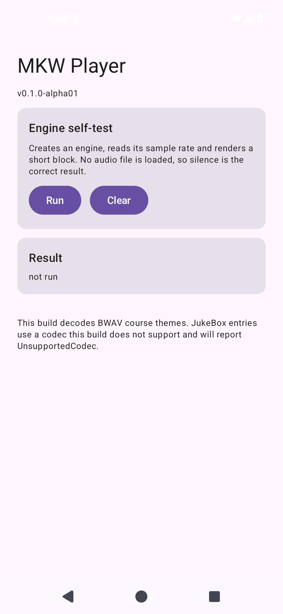
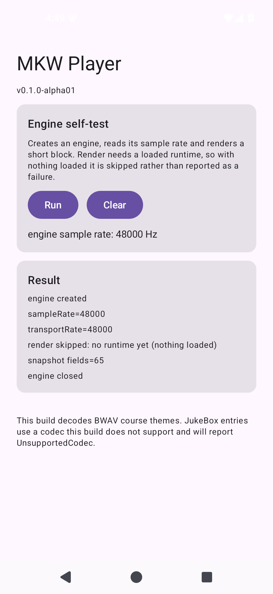

# AND-09 · 应用界面与状态显示

- **checked_at**: 2026-11-08T02:15+08:00 (Asia/Shanghai)
- **证据级别**: **S5 设备截图** —— 界面在模拟器上真实运行

---

## 1. 界面现状

这是**自检界面**，不是播放器 UI。目的是让引擎路径能在真机上手动跑一次，并把结果显示成**名字**而不是数字。

| 元素 | 内容 |
|---|---|
| 标题 | MKW Player / v0.1.0-alpha01 |
| Engine self-test | 说明文字 + Run / Clear 按钮 |
| 结果卡片 | 逐行显示执行结果 |
| 底部说明 | 明确写出 JukeBox 不支持 |

## 2. 首次运行截图



## 3. 点击 Run 后



输出：

```
engine created
sampleRate=48000
transportRate=48000
render skipped: no runtime yet (nothing loaded)
snapshot fields=65
engine closed
```

外加一行大字：`engine sample rate: 48000 Hz`

---

## 4. 一个被界面暴露出来的真实语义

第一版跑出来是：

```
render failed: null buffer
```

**看起来像 bug，其实是正确行为。**

`renderEngineControl` 在**没有 runtime** 时返回 `InvalidRequest`：

```cpp
if(!engine || !engine->runtime || !stereo || frames>65536)
    return EngineStatus::InvalidRequest;
```

刚 `createEngine()` 完、还没加载任何图或源时，**确实没有 runtime**。

**修正**：把这一行改成 `render skipped: no runtime yet (nothing loaded)`，并在说明文字里写清「render 需要已加载的 runtime」。

> **这正是 AND-08 里加 `AudioStatusText` 的理由**：如果界面只显示 `1`，没人能看出这是「正常跳过」还是「出错」。

## 5. 状态码命名（本轮新增 10 个测试）

`AudioStatusText` 把两套枚举翻译成人话：

| 来源 | 覆盖 |
|---|---|
| `EngineStatus` | 0..11，全部命名 |
| `SourceStatus` | 0..14，全部命名 |

关键设计：

| 规则 | 原因 |
|---|---|
| 未知码显示 `UNKNOWN(99)` 并保留数字 | **绝不**静默当成 Ok |
| `engineIsOk()` 只对 0 返回 true | 防止 -1 或未知码被当成功 |
| `UnsupportedCodec` 的提示**不含** "malformed" | kind=2 是已知限制，不是文件损坏 |
| `malformed` 与 `unsupported` 提示不同 | 用户该做的事不一样 |

测试 `unsupportedCodecSaysSoInsteadOfLookingCorrupt` 专门钉这条。

## 6. 明确未做

| 项 | 状态 |
|---|---|
| 文件选择器 | **未做** |
| 曲库列表 | **未做** |
| 播放控制（播放/暂停/进度） | **未做** |
| 真实播放的 UI 接线 | **未做** |
| 界面视觉最终确认 | **未提交评审**（交接包要求用户最终确认） |

**当前界面无法播放任何音频**，它只验证引擎能创建、能读采样率、能出快照。

## 7. 测试总数

| 套件 | 数量 |
|---|---|
| Python | 143 |
| Kotlin JVM | **35** |
| Android Instrumentation | 17 |
| **合计** | **195** |
