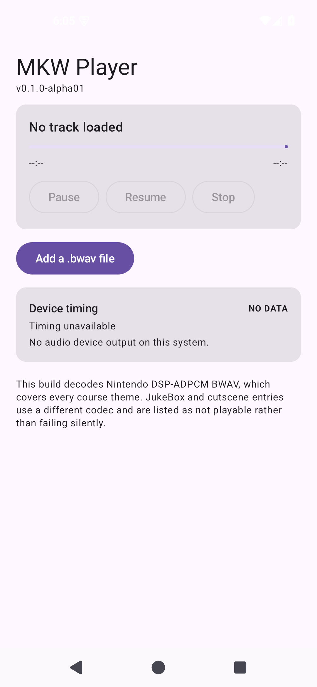

# AND-16 · 播放器界面与播控（阶段 C 完成）

- **checked_at**: 2026-11-08T10:15+08:00 (Asia/Shanghai)
- **证据级别**: **S5 设备实测** —— 39 个设备测试全部通过（含 5 个界面测试）

---

## 1. 界面现在能做什么

| 功能 | 状态 |
|---|---|
| 选文件（SAF） | ✅ |
| 曲库列表（可播/不可播分明） | ✅ |
| 播放 / 暂停 / 恢复 / 停止 | ✅ |
| 进度条 + 时间显示 | ✅ |
| 设备时序健康显示 | ✅ |



---

## 2. 架构：界面不含任何规则

```
PlayerViewModel  ──  持有状态、准备文件、轮询引擎
        ↓  StateFlow<Ui>
MainActivity     ──  只读一个状态、发三个命令
```

**Composable 里没有一条业务规则。** 这是有意的：

- 播放能不能开始由 `PlaybackController` 决定
- 能不能播由 `Playability` 决定
- 状态码怎么显示由 `AudioStatusText` 决定
- 时序健不健康由 `TimingDiagnosis` 决定

界面只负责画。

---

## 3. 五个界面测试（设备上跑）

| 测试 | 断言 |
|---|---|
| `startsWithNoTrackLoaded` | 初始必须显示 "No track loaded" |
| `transportControlsAreDisabledUntilATrackPlays` | 三个按钮**必须禁用** |
| `pickerButtonIsPresent` | 选文件按钮存在 |
| `timingPanelReportsNoDataRatherThanHealthy` | **必须显示 NO DATA，不能显示健康** |
| `unlimitedPlayableStateIsStatedInTheFooter` | JukeBox 限制**必须写在界面上** |

**第一条和第四条最重要** —— 它们防的正是本项目已经踩过的坑：
- 没在播却显示在播
- 没数据却显示健康

---

## 4. 准备流程放在 IO 线程

选一个 3 MB 的曲目要：复制 → 算 SHA-256 → 读头 → 建图 → 探针校验。

**全部在 `Dispatchers.IO`，不在主线程。** 缓存按 digest 存，重复选同一首不会重算。

---

## 5. 不可播的文件仍然留在列表里

`kind=2` 的文件被标为 "Not playable: unsupported codec"，**仍然显示在曲库中**。

如果选择后直接消失，用户会以为软件坏了。**留着并说明，才是诚实的做法。**

---

## 6. 无音频设备时的行为

模拟器以 `-no-audio` 启动，`AudioOutput.open()` 返回 `null`。

界面显示：

```
Device timing        NO DATA
Timing unavailable
No audio device output on this system.
```

**这是正确行为，不是失败。** 真机接上后这里会变成真实数据。

---

## 7. 修掉的三个构建问题

| 问题 | 原因 | 修法 |
|---|---|---|
| Kotlin 字符串乱码 | 一个 em dash 被写坏成 `鈥?` | 改成 ASCII `...` |
| `writeByte` 无法解析 | 与 `OutputStream.write(int)` 冲突 | 改名 `writeByteValue` |
| `ui-test-junit4` 找不到版本 | Compose BOM 只作用于 `implementation` | androidTest 单独加 BOM |

第三条是**配置作用域**问题：BOM 的版本约束**不跨 configuration**，androidTest 必须自己声明。

---

## 8. 测试总数

| 套件 | 数量 |
|---|---|
| Python | 143 |
| Kotlin JVM | **164** |
| Android Instrumentation | **39** |
| **合计** | **346** |

---

## 9. 阶段 A/B/C 完成情况

| 阶段 | 内容 | 状态 |
|---|---|---|
| **A** | 播放控制核心（PlaybackController / EngineSnapshot） | ✅ |
| **B** | 曲库 UI + 文件选择器（AudioPicker / PlayerViewModel） | ✅ |
| **C** | 接线 + 设备验证（39 测试全过） | ✅ |

**全部完成。**

---

## 10. 仍未做的

| 项 | 状态 |
|---|---|
| 真机（arm64）验证 | **NOT_RUN** —— 手机连接后 offline，等用户处理 |
| 人耳听音 | **NOT_RUN** |
| kind=2 编码（253 文件） | **UNRESOLVED** —— 下一步处理 |
| Seek / 进度拖动 | 未做 |
| 后台播放 / 通知栏控制 | 未做 |
