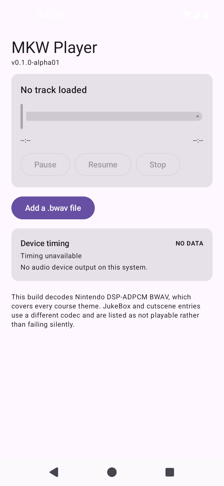

# AND-18 · Seek 与可拖动进度条

- **checked_at**: 2026-11-08T10:55+08:00 (Asia/Shanghai)
- **证据级别**: **S5 设备实测**（42 个设备测试全过，含 3 个 seek 测试）

---

## 1. 做了什么

| 层 | 内容 |
|---|---|
| `SeekTarget` | 进度比例 ⇄ 帧号转换，全部钳位 |
| `PlaybackEngine` | 新增 `seek(frame)` |
| `PlaybackController` | `seek(frame)`，超出范围**拒绝**而非钳位 |
| `PlayerViewModel` | `seekTo(fraction)` |
| 界面 | `LinearProgressIndicator` → **可拖动 `Slider`** |

---

## 2. 为什么转换要单独成类

拖动进度条时，手势可能给出**任何**浮点数：负数、大于 1、`NaN`、`±∞`。

直接乘总帧数会得到荒谬的播放位置。所以 `SeekTarget.fractionToFrame` **全部钳位**：

| 输入 | 输出 |
|---|---|
| `-5f` | 0 |
| `42f` | 总帧数 |
| `NaN` | 0 |
| `+∞` | 总帧数 |
| `-∞` | 0 |
| 时长 0 | 0 |

有一条测试**扫过 -0.5 到 1.5 的每 0.01 步长**，断言结果永远落在 `0..总帧数` 内。

---

## 3. 两层的职责划分

| 层 | 越界行为 | 理由 |
|---|---|---|
| `SeekTarget` | **钳位** | 手势噪声是常态，钳位让进度条手感正常 |
| `PlaybackController` | **拒绝并报错** | 到这里还越界说明上游有 bug，必须暴露 |

**这个区分是有意的。** 如果两层都钳位，上游的错误会被永久掩盖。

测试 `seekPastTheEndFailsWithoutCallingTheEngine` 断言：
- 返回 `Failed`
- **`engine.seekCalls == 0`** —— 越界请求根本不进原生层

---

## 4. 设备上的三个 seek 测试

| 测试 | 断言 |
|---|---|
| `seekRepositionsTheTransport` | seek 到 50% 后，**快照帧号 == 目标帧号** |
| `audioContinuesAfterSeek` | seek 后继续渲染，**仍然非静音** |
| `seekBeforeLoadIsRejected` | 没加载时 seek **必须失败** |

第二条最重要 —— 它防的是「位置动了但声音没了」。

---

## 5. 一个容易忽略的细节

`seekRepositionsTheTransport` 先渲染一小段**再** seek。

如果直接 seek，可能测到「本来就在 0，seek 到 0 也算成功」的假阳性。先让传输真的动起来，再验证它确实被重定位。

---

## 6. 测试总数

| 套件 | 数量 |
|---|---|
| Python | 143 |
| Kotlin JVM | **203** |
| Android Instrumentation | **42** |
| **合计** | **388** |

---

## 7. 仍未做

| 项 | 状态 |
|---|---|
| 后台播放 / 通知栏控制 | **未做** |
| 内置曲目索引接入 UI | **未做** |
| 真机 arm64 验证 | **NOT_RUN** |
| 人耳听音 | **NOT_RUN** |
| codec 2 解码 | **UNRESOLVED** |
