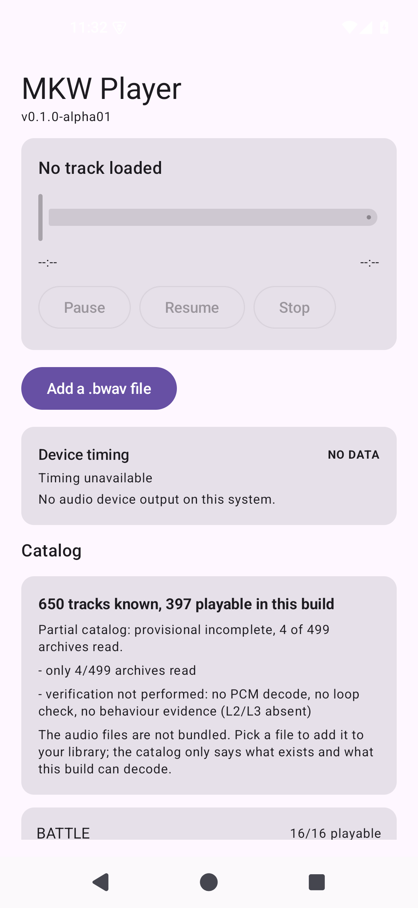

# AND-22 · 内置曲库目录（650 条）

- **checked_at**: 2026-11-08T15:55+08:00 (Asia/Shanghai)
- **证据级别**: JVM 15 测试 + 设备 9 测试（实测资产，非夹具）

---

## 1. 做了什么

把 650 条曲目**清单**打进 APK，但**不是**把音频打包进去。

| 之前 | 现在 |
|---|---|
| 只能手动选文件，不知道游戏里有什么 | 知道 650 条曲目、分类、哪些能解 |
| 遇到 kind=2 只说 unsupported | 目录里明确标 `227 条 JukeBox 全部不可播` |



---

## 2. 为什么这不是「假的曲库」

清单说的是**「存在什么」**和**「这个版本能解什么」**，不是「你有什么」。

界面原文：

> The audio files are not bundled. Pick a file to add it to your library;
> the catalog only says what exists and what this build can decode.

**每条目录项都是「已知」而非「可用」。** 这个区别写在界面上，不是藏在代码注释里。

---

## 3. 生成流程（可复现）

`tools/gen_catalog.py` 把交接索引与**真实 BWAV 头部**连接：

```
reports/generated/temporary-index.json  (650 条，含名称与分类)
        ↓ 按 internalName 找 romfs 里的 .bwav
        ↓ 读真实头部：codecKind / sampleRate / channels / frames / loop
app/src/main/assets/catalog.json        (167 KB)
```

**只写实测字段，不留猜测。** 索引本身没有 codec 信息，所以这一层是必需的。

### 生成结果

```
entries: 650  playable: 397
missing sources: 0  unreadable: 0
by category: {BATTLE:16, BOOT:1, COURSE:338, CUTSCENE:22, DEMO:4,
              JUKEBOX:227, MISSION:5, SEQUENCE:34, SOUND_EFFECT:3}
playable:    {BATTLE:16, BOOT:1, COURSE:338, DEMO:1,
              MISSION:5, SEQUENCE:33, SOUND_EFFECT:3}
```

**COURSE 338/338 可播，JUKEBOX 0/227，CUTSCENE 0/22** —— 与此前实测分布完全一致。

---

## 4. 覆盖声明随数据一起打包

源索引自己的字段被**原样保留**并在界面显示：

```
Partial catalog: provisional incomplete, 4 of 499 archives read.
- only 4/499 archives read
- verification not performed: no PCM decode, no loop check,
  no behaviour evidence (L2/L3 absent)
```

**如果丢掉这两行，界面就会把 650 条说成完整原声带** —— 一个无法撤回的假陈述。

`Catalog.isPartial` 由 `freezeStatus != "FROZEN" || coverage != "COMPLETE"` 判定，有测试钉住。

---

## 5. 修掉一个静默的错误：循环点全部丢失

第一版生成的 catalog 里**所有 loopStart 都是 null**。

原因：我在 `gen_catalog.py` 里用了偏移 48 和 8，而 `BwavHeader.kt` 用的是 **60（loopLast）和 64（loopFirst）**。

```python
# 错
loop_start = u32(8)
loop_end = u32(48)
# 对
loop_last  = u32(60)
loop_first = u32(64)
```

### 抓到它的方式

设备测试断言 `BGM_Stage_Coaster` **必须带循环点**：

```
loopPointsArePresentForACourseTheme FAILED
  a course theme should carry loop points
```

修完后：

```
{"name":"BGM_Stage_Coaster","loopStart":493714,"loopEnd":3373711,"playable":true}
```

`493714 / 3373711` **与之前独立的设备实测值完全一致**。650 条中 174 条带循环点。

**这个 bug 不会崩溃、不会报错，只会让循环静默失效。**

---

## 6. 修掉第二个真 bug：前台服务拒绝启动

`PlaybackSession` 的 `playing` 来自引擎快照，但引擎的 Play 走**命令队列** —— 同一瞬间取快照可能仍是 `Stopped`。

于是 `PlaybackService.start()` 的守卫（`if (!active) return false`）在加载成功后**立刻拒绝启动**。

### 修法：区分「已命令」与「引擎报告在播」

```kotlin
data class State(
    val playing: Boolean,   // 引擎说在播
    val loaded: Boolean,    // Play 已被接受
) {
    val active get() = playing || paused || loaded
}
```

- 前台服务看 `active`（需要的是「有东西要保活」）
- 通知按钮看 `playing`（需要的是「现在能不能暂停」）

**两者含义不同，混用就会出错。**

---

## 7. 测试

| 套件 | 内容 |
|---|---|
| JVM 15 | 解析、版本、缺失字段、循环点 null vs 0、分类去重、文件名匹配、除零 |
| 设备 9 | **读真实资产**：650/397、每条字段完整、playable ⇔ codecKind==1、不可播必带原因、覆盖声明未被构建丢弃、COURSE 338、JUKEBOX 0/227、按名匹配、循环点存在 |

设备的 9 条读的是**打包进 APK 的真实资产**，不是夹具 —— 防的正是「生成器产出解析器不认的文档」这类构建期故障。

---

## 8. 测试总数

| 套件 | 数量 |
|---|---|
| Python | 143 |
| Kotlin JVM | **242** |
| Android Instrumentation | **69** |
| **合计** | **454** |

---

## 9. 目标完成情况

| 目标 | 状态 |
|---|---|
| (1) 曲库持久化 | ✅ `d560b1d` |
| (2) 后台播放 + 媒体控制 | ✅ `5437423` |
| (3) 内置 650 条目录 | ✅ 本次 |
| (4) 测试/证据/提交/汇报 | ✅ |

---

## 10. 仍未做

| 项 | 状态 |
|---|---|
| 音频焦点（来电暂停） | 未做 |
| 目录项直接播放（需用户配合文件夹） | 未做 |
| 真机 arm64 | NOT_RUN |
| 人耳听音 | NOT_RUN |
| codec 2 解码 | UNRESOLVED |
