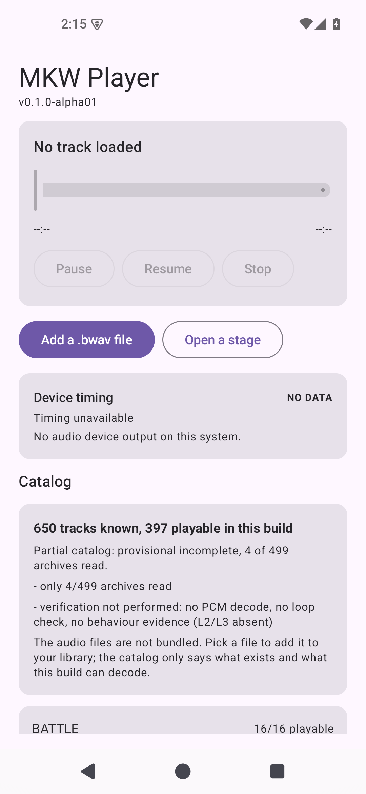

# AND-29 · 多段流程接入界面

- **checked_at**: 2026-11-08T18:20+08:00 (Asia/Shanghai)
- **证据级别**: JVM 29 + 设备 4（界面）
- **关键结论**: 界面上可以一次选中五段文件，编译成流程，逐段播放

---

## 1. 界面现在能做什么



| 元素 | 作用 |
|---|---|
| **Add a .bwav file** | 单文件（原有功能，未变） |
| **Open a stage** | **多选**五段文件，自动识别为同一个赛道 |
| 流程卡片 | 标题、`6 parts, 2 outros`、**PROVISIONAL 红字警告** |
| 段列表 | Pre (short) / Pre / Bridge / Main / Outro 00 / Outro 01，各带时长 |
| 每段的 Play | 请求该段；当前段显示 **Playing** 且按钮禁用 |

---

## 2. 两处刻意设计

### 2.1 「Open a stage」是必需的，不是便利

一个赛道是**五个兄弟文件**。逐个选中极易漏掉 Bridge 或选错 Outro。

但更重要的是：**发现逻辑本身需要多选才有意义**。`StageFlowDiscovery` 按前缀分组，如果每次只给一个文件，它永远只能看到一组。

### 2.2 起始段永远不是 Outro

```kotlin
fun entrySection(compiled): Int =
    segmentByRole[Pre] ?: segmentByRole[PreShort] ?: segmentByRole[Main] ?: ...
```

**从结局开始不是聆听，是片段。** 有测试专门断言这一点。

---

## 3. PROVISIONAL 警告必须显示

```
Testing configuration: section timings are this app's choice, not the game's.
```

用**红色粗体**显示在流程卡片里。

**为什么不能省**：如果只显示曲目名和时长，用户会理所当然地认为这是游戏原版行为。而实际上：

| 内容 | 来源 |
|---|---|
| 五段文件、各自长度、循环窗口 | 实测 BWAV 头部（L1） |
| 各段解码正确 | 逐样本对照（L2） |
| **何时进 Bridge、何时出 Outro** | **本项目自己选的** |

**没有 L3 证据就不配说「还原」。**

---

## 4. 本轮做的管道（拆成两个提交）

### 4.1 `PlaybackSession.loadFlow`

```kotlin
fun loadFlow(title, packet, assets: List<Pair<String, ByteArray>>, frames, startSegment)
```

顺序很重要：**加载图 → 逐段绑定 → 播放**。

绑定在播放期间会被拒绝，所以 `loadGraphOnly` 和 `playSegment` 从原来 `load()` 的一步里拆出来了。

**按编译器的 asset 顺序绑定** —— 槽位不会和声明悄悄错开。

### 4.2 `StageFlowDiscovery`

按「角色后缀之前的前缀」分组：

```
BGM_Stage_Coaster_Pre_Short.bwav  ┐
BGM_Stage_Coaster_Pre.bwav        │
BGM_Stage_Coaster_Bridge.bwav     ├─ BGM_Stage_Coaster
BGM_Stage_Coaster.bwav            │
BGM_Stage_Coaster_Outro00.bwav    ┘
```

**最长后缀优先** —— 否则 `_Pre_Short` 会被当成 `_Pre`，一个赛道被拆成两组。

### 4.3 `FlowPresentation`

| 函数 | 作用 |
|---|---|
| `sections()` | 按**听到的顺序**排序（Bridge 在 Main 前） |
| `entrySection()` | 起始段，永不为 Outro |
| `provenanceLabel()` | 那句红色警告 |
| `summary()` | `6 parts, 2 outros` |
| `totalFrames()` | 只加结构段，**不加 Outro** |

最后一条：Outro 是可选的结尾，算进总时长会高估一次聆听的长度。

---

## 5. 一个测试写错了，改的是测试

`aGroupWithTwoMainsFails` 原本通过文件名构造「两个 Main」。但发现逻辑会让未知后缀变成独立前缀，**这条路根本走不通**。

改成手工构造 `Group`，并在注释里说明：

> The refusal is real and still checked, on a hand-built group, and the test says why rather than pretending the path is reachable.

**代码没改，因为代码是对的；改的是我最初对可达性的错误假设。**

---

## 6. 测试结果（本轮实际执行）

| 命令 | 结果 |
|---|---|
| `python -m pytest tests -q` | 143 passed |
| `./gradlew :app:testDebugUnitTest` | **368 tests, 0 failures** |
| `./gradlew :app:connectedDebugAndroidTest` | **105 tests, 0 failures** |

合计 **616**。设备 `mkw_test(AVD)` Android 15 **x86_64 模拟器**。

---

## 7. 界面测试只验证「有没有」，不验证「点下去会怎样」

`FlowScreenTest` 4 条：
- `Open a stage` 按钮存在
- `Add a .bwav file` 仍在（未退化）
- 未开流程时不显示 "Playing"
- 未开流程时不显示 PROVISIONAL 警告

**没有一条真的点击选文件** —— 因为 SAF 文件选择器需要真实用户交互，仪器测试无法可靠驱动。

所以：**「点 Open a stage → 选五个文件 → 听到流程」这条完整路径，本轮没有自动化验证。**

这是真实缺口，不是遗漏。

---

## 8. 仍未验证

| 项 | 状态 |
|---|---|
| **UI 端到端**（点按钮 → 选文件 → 出声） | **NOT_VERIFIED**（见 §7） |
| 多选后分组是否正确 | 仅 JVM 验证 |
| 真机 arm64 | 未验证 |
| Bridge 重叠 | 未验证 |
| 人耳听多段流程 | 未验证 |

---

## 9. 下一步

1. **手动验证 UI 路径** —— 需要你在模拟器或真机上点一次「Open a stage」，选五个文件（`coaster-*.bwav` 已在 `/data/local/tmp/`，但 SAF 看不到那个目录，需要先在手机上放置文件）
2. **Bridge 重叠测量** —— 需要更细的 voice 明细，可能要扩展原生快照
3. **阶段 D：曲库与资源管理** —— 目录冻结、稳定 ID、批量导入
