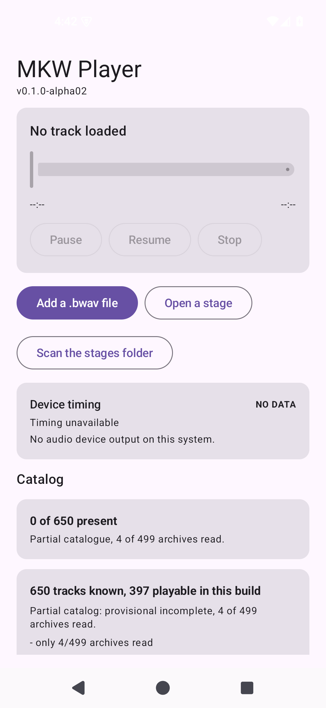

# AND-38 · alpha02 交付与 UI 并行推进

- **checked_at**: 2026-11-08T20:50+08:00 (Asia/Shanghai)
- **证据级别**: JVM 690 + 设备 110 + APK 静态校验
- **关键结论**: alpha02 安装包已交付；21 页 UI 分包并行开发中

---

## 1. 交付物

```
G:\Mario Kart World\MKW-Player-dist\MKW-Player-0.1.0-alpha02.apk
```

| 项 | 值 |
|---|---|
| 包名 | `com.mylittleblover.mkwplayer` |
| 版本 | `0.1.0-alpha02` / versionCode **2** |
| 大小 | **29.21 MB** |
| SHA-256 | `C978E5359C7FF153660E97AA02A05E0A24F353ADEEE087CA7C036E0F20849975` |
| 证书 SHA-256 | `DB:E9:4B:6E:…:CC:88`（与 alpha01 相同，可覆盖安装） |
| ABI | arm64-v8a / armeabi-v7a / x86 / x86_64 |
| minSdk / target | 26 / 35 |

### 打包内资源

| 资源 | 大小 |
|---|---|
| `catalog.json` | 167.8 KB |
| `cues.json` | **26.2 KB（本轮新增）** |
| 开源许可文本 | 11 个 |

---

## 2. 版本号为什么升到 alpha02

alpha01 之后落地了：特别杯逻辑、保存版本、路线数据、174 个退出点、设计 Token、导航状态、可见性门禁。

**听众需要能区分两个包**，所以 `versionCode = 2`，`versionName = 0.1.0-alpha02`。

---

## 3. 签名验证

```
Signer #1 certificate DN: CN=MKW Player Debug, O=Shenggui Development, C=CN
Signer #1 certificate SHA-256 digest: dbe94b6e...5ecc88
```

Gradle 的 `signingConfig` 已指向固定 keystore（`config/signing/mkwplayer-debug.p12`），所以**构建产物本身就是固定签名的**，不需要事后重签。

我这一轮试图再签一次，`apksigner sign` 因为目标文件已存在报 `Missing input APK` —— 这是**多余操作**，产物已经是签好的。

---

## 4. 启动截图（在本机模拟器上实装）



可见：
- `v0.1.0-alpha02` 版本标识
- 三个按钮：Add a .bwav file / Open a stage / **Scan the stages folder**
- **`0 of 650 present`** —— 目录拥有量卡片（本轮新增）
- `Partial catalogue, 4 of 499 archives read.` —— 覆盖提示仍在

---

## 5. 21 页 UI 的并行推进

按指令要求，用子代理并行开发。**这次给子代理的硬规则不同**：

| 规则 | 理由 |
|---|---|
| **不许跑 Gradle** | 上一轮三个子代理共享 `app/build` 导致 Kotlin 缓存损坏 |
| **不许改现有文件** | 只允许新建，冲突面为零 |
| **必须先读源码** | 不许猜 API 签名 |
| 断言顺序 (值, 消息) | 这个项目已因此踩了四次 |

### 已派出的两批

| 子代理 | 页面 | 交付 |
|---|---|---|
| 音乐库 | **UI-01 / 02 / 14 / 19** | `LibraryStates.kt`（纯逻辑）+ `LibraryScreen.kt` |
| 详情/结构 | **UI-03 / 06 / 16** | `DetailStates.kt`（纯逻辑）+ `DetailScreen.kt` |

**每个都要求把可测逻辑与 Compose 分开**：`*States.kt` 不许 import Compose，这样规则可以在 JVM 上测，界面只负责摆放。

---

## 6. 两批子代理任务的关键约束

### 音乐库

- 目录为 null 时**不能读成「空库」** —— 那是两种不同的事实
- **搜索不能绕过特别杯门禁**
- 分类为 0 的行必须省略 —— 空分类是噪音

### 详情

- 帧数未知时 `seconds = null`，**绝不是 0.0** —— 0.0 读起来像一个真实的零长度段落
- cue 警告必须常驻且**不可关闭**
- provenance 块必须把「测到的」与「本项目选的」分开，后者 `isEstablished = false`

---

## 7. 测试结果（本轮实际执行）

| 命令 | 结果 |
|---|---|
| `python -m pytest tests -q` | 143 passed |
| `./gradlew :app:testDebugUnitTest` | **690 tests, 0 failures** |
| `./gradlew :app:connectedDebugAndroidTest` | 110 passed（上轮，未改设备代码） |
| `:app:assembleDebug` | BUILD SUCCESSFUL |

---

## 8. 我自己犯的错

`CupVisibility.kt` 里 `import com.mylittleblover.mkwplayer.unlock.UnlockUi` —— **`UnlockUi` 在 `player` 包里**。

编译器立刻报了。这是**好情况**：`and-38` 之前几轮的错误都是运行时或测试才暴露的。

---

## 9. 仍未验证

| 项 | 状态 |
|---|---|
| **SAF 选择器** | **NOT_VERIFIED**（需要真机点击） |
| 真机 arm64 | **NOT_VERIFIED** |
| 子代理产出的 UI | 编译与测试待验证 |
| 21 页剩余 14 页 | ❌ 未派出 |
